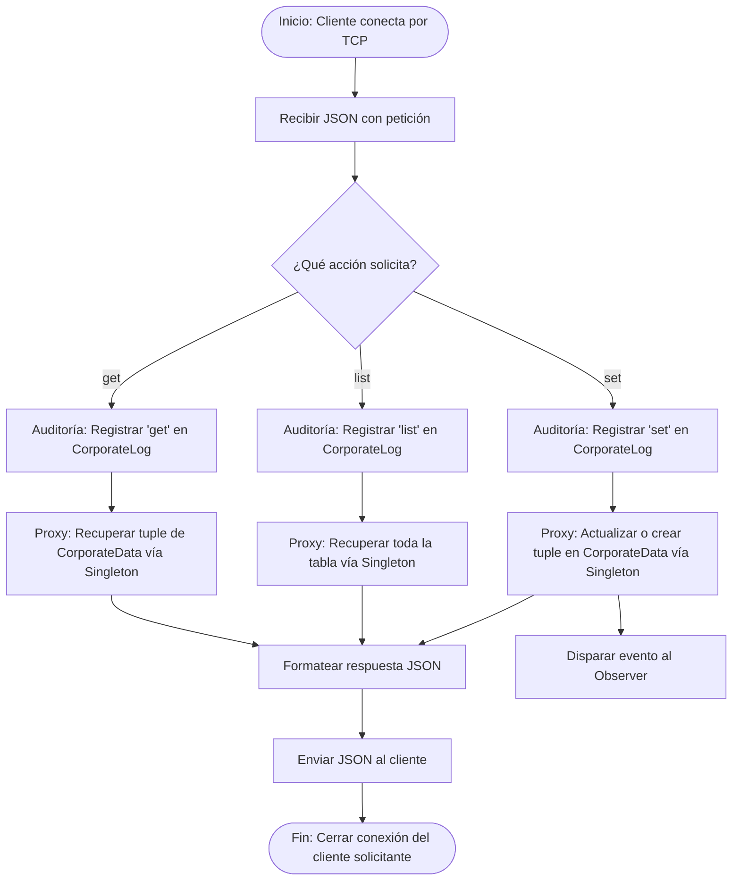
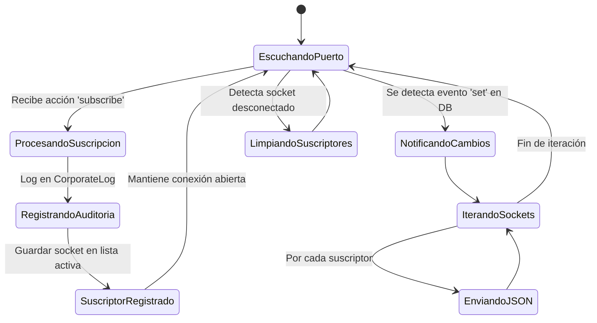

# TPFI IS2 AWS - Patrones Singleton, Proxy y Observer con DynamoDB

Trabajo Práctico Final Integrador (TPFI) de **Ingeniería de Software II (UADER - FCyT)**.
Implementación de una arquitectura cliente-servidor TCP en Python que gestiona el acceso a **AWS DynamoDB** (`CorporateData` y `CorporateLog`) utilizando los patrones de diseño **Singleton**, **Proxy** y **Observer**.

* **Autora:** [Maiten Blanc](https://github.com/MaitenBlanc)
* **Versión:** `1.0.0` | **Build:** `001`
* **Licencia:** MIT License

---

## Características Principales

* **Patrón Singleton (`DatabaseSingleton`):** Acceso único y *thread-safe* a las tablas `CorporateData` y `CorporateLog` en AWS DynamoDB mediante `boto3`.
* **Patrón Proxy (`CorporateDataProxy`):** Intermediario que intercepta todas las peticiones (`get`, `list`, `set`, `subscribe`), registra obligatoriamente una pista de auditoría en `CorporateLog` (`UUID`, `sesion`, `accion`, `timestamp`) y delega la operación al Singleton.
* **Patrón Observer (`ObserverManager`):** Gestión de clientes suscriptos mediante sockets TCP abiertos y notificación automática en tiempo real ante cada actualización (`set`) en la base de datos.
* **Calidad y CI/CD:** Validación continua con `black`, `ruff`, `mypy`, `bandit`, `pytest` (cobertura > 85%) y generación de documentación con `pdoc` mediante GitHub Actions.

---

## Diseño de Arquitectura (Diagramas UML)

### 1. Diagrama de Actividad UML (Gestión Proxy)
Modela cómo se gestionan internamente las acciones `list`, `get` y `set` dentro del servidor de aplicaciones:



### 2. Diagrama de Estado UML (Gestión Observer)
Representa la gestión de las suscripciones usando el patrón Observer en el servidor:



---

## Instalación y Configuración

1. **Crear y activar el entorno virtual:**
   ```bash
   python3 -m venv TPF
   source TPF/bin/activate
   ```

2. **Instalar dependencias y el paquete en modo editable:**
   ```bash
   pip install -r REQUIREMENTS.txt
   pip install -e .
   ```

3. **Configurar credenciales de AWS CLI:**
   ```bash
   aws configure
   ```
   *(Ingresar `AWS Access Key ID`, `AWS Secret Access Key` y región `us-west-2`).*

---

## Guía de Uso y Pruebas Manuales (Fases 3 y 4)

Abrir **tres terminales** con el entorno virtual activado desde la raíz del proyecto:

### Terminal 1: Servidor (`singletonproxyobserver.py`)
```bash
python src/tpfi_is2_aws/singletonproxyobserver.py -p 8080 -v
```

### Terminal 2: Cliente Observador (`observerclient.py`)
```bash
python src/tpfi_is2_aws/observerclient.py -s localhost -p 8080 -o data/salida_observer.json -v
```

### Terminal 3: Cliente Transaccional (`singletonclient.py`)
* **Listar registros (`list`):**
  ```bash
  python src/tpfi_is2_aws/singletonclient.py -i data/input_list.json -v
  ```
* **Consultar un registro (`get`):**
  ```bash
  python src/tpfi_is2_aws/singletonclient.py -i data/input_get.json -v
  ```
* **Actualizar un registro y disparar notificación al Observer (`set`):**
  ```bash
  python src/tpfi_is2_aws/singletonclient.py -i data/input_set.json -v
  ```

---

## Testing, Calidad y Cobertura (Fase 5)

### 1. Tests Unitarios (con Mocks) y Cobertura (> 85%)
```bash
pytest --cov=src/tpfi_is2_aws tests/test_tpfi_is2_aws.py --cov-fail-under=85
```

### 2. Tests de Aceptación (Integración Real con AWS DynamoDB)
Evalúa servidor caído, argumentos malformados, doble apertura de puerto, datos mínimos e impacto real en `CorporateData` y `CorporateLog`:
```bash
python3 test_aceptacion.py
```

### 3. Validaciones de Formato, Tipado, Seguridad y Documentación
```bash
black --check src/ tests/
ruff check src/ tests/
mypy src/
bandit -r src/ -ll
pdoc src/tpfi_is2_aws -o docs_output
```